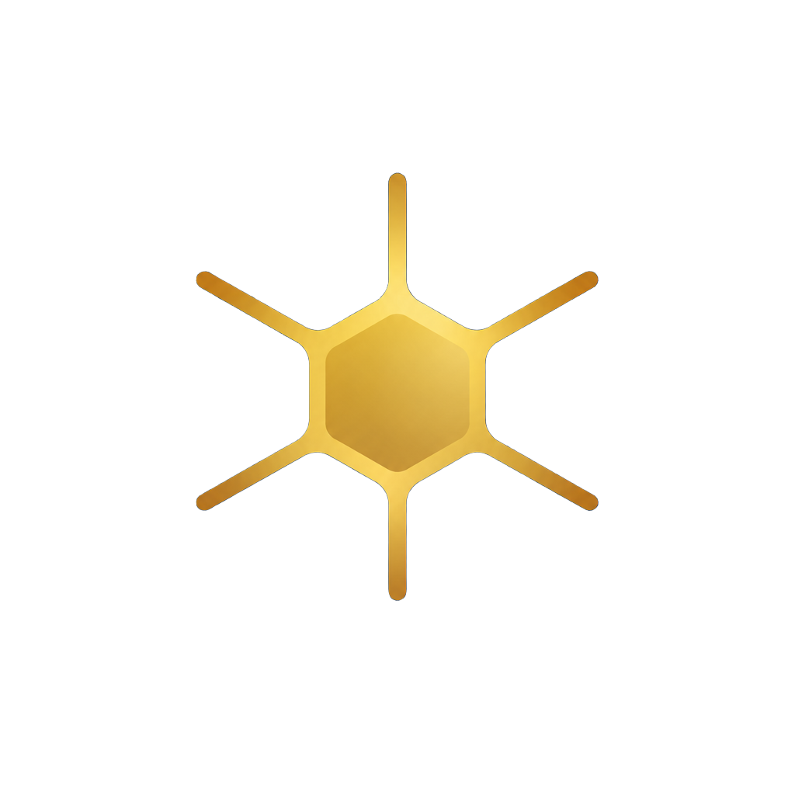

<p align="center">
  
</p>

<h1 align="center">merSETA Extractor — AI Navigator</h1>

<p align="center">
  <b>National Skills Registry & Intelligence Engine</b><br />
  Production-grade AI workspace for automated document extraction, skills mapping, and occupational intelligence.
</p>

<p align="center">
  <a href="https://merseta-ai.vercel.app/"></a>
  
  
  
  
</p>

---

## 🌐 Live Access

- **Production URL**: [https://merseta-ai.vercel.app/](https://merseta-ai.vercel.app/)
- **Institutional Context**: Developed under the Wits–merSETA Skills Mapping Platform & National Skills Registry Initiative.

---

## 📖 Overview

**merSETA Extractor** is an institutional intelligence workspace inspired by the clean interaction principles of modern conversational AI (Claude, ChatGPT, Gemini). It enables researchers, industrial analysts, and policy planners to ingest technical documentation, curricula, and sector reports to:

1. **Extract Structured Skills**: Identify verified technical competencies and capability signals from complex industrial reports.
2. **Map to National Frameworks**: Calibrate extracted skills against the South African National Qualifications Framework (NQF) levels and merSETA Sector Priority Lists.
3. **Bridge Capability Gaps**: Highlight high-impact bridge capabilities connecting current competency baselines to high-demand senior engineering and industrial roles.
4. **Inspect Evidence with Citations**: Review grounded textual excerpts, page coordinates, and confidence ratings behind every extracted insight.

---

## 🚀 Key Features

- **Grounded Conversational Intelligence**: Research chat interface built with AI Elements primitives, featuring message streaming, evidence citation cards, copy/regenerate actions, and shimmer states.
- **Document Ingestion & Reader**: Multi-state intake workflow (idle, drag-over, parsing, structuring, verified) with split-panel evidence inspection.
- **Skills Matrix & Bridge Recommendations**: Visual competency breakdown across industrial clusters (Robotics, PLC Programming, Systems Integration, Predictive Maintenance).
- **Dual Co-Branding & Editorial Aesthetics**: Editorial layout using warm paper canvases (`#FBFAF7`), deep navy authority (`#1D3557`), and gold italics accents (`#D4AF37`).
- **Accessible & Responsive**: Fully keyboard-accessible navigation (Cmd/Ctrl + K command palette), collapsible desktop sidebar, slide-out mobile drawer, and instant light/dark theme toggle.

---

## 🏛️ Master Design Schema (v2.4)

The platform adheres to an editorial, human-centered design language combining academic authority with modern software agility.

### 1. Foundations & Color Tokens

All core palette combinations meet **WCAG 2.2 AAA / AA** contrast standards against the editorial canvas.

| Token Variable | Hex Code  | RGB Equivalent       | Contrast on `#FBFAF7`    | Design Role                                                    |
| :------------- | :-------- | :------------------- | :----------------------- | :------------------------------------------------------------- |
| `--navy`       | `#1D3557` | `rgb(29, 53, 87)`    | **11.4:1** (AAA)         | Authoritative base, headers, primary buttons, hero text        |
| `--navy-soft`  | `#28496F` | `rgb(40, 73, 111)`   | **8.5:1** (AAA)          | Hover states, secondary navigation titles, subtle borders      |
| `--gold`       | `#D4AF37` | `rgb(212, 175, 55)`  | **2.1:1** (Graphical/Em) | Editorial headline emphasis `<em>`, active indicators, accents |
| `--amber`      | `#A86F1C` | `rgb(168, 111, 28)`  | **4.7:1** (AA Large)     | Eyebrow badges, match percentages, capability gap signals      |
| `--green`      | `#2F755B` | `rgb(47, 117, 91)`   | **5.2:1** (AA)           | Verified skill indicators, high-confidence metrics             |
| `--paper`      | `#FBFAF7` | `rgb(251, 250, 247)` | Root Surface             | Warm editorial canvas for all viewport page shells             |
| `--line`       | `#DFE4E8` | `rgb(223, 228, 232)` | Hairline Rule            | 1px architectural dividers, grid lines, input hairlines        |
| `--ink`        | `#111827` | `rgb(17, 24, 39)`    | **16.1:1** (AAA)         | Primary body text, high-contrast values, form labels           |

### 2. Typography & Hierarchy

- **Primary Typeface**: Open Sans Humanist (`font-sans`)
- **Tone**: Quiet authority with tight headline tracking (`-0.035em`) and selective italic gold highlights (`<em>`).

| Level                  | Size / Weight           | Line Height | Tracking   | Purpose                                                    |
| :--------------------- | :---------------------- | :---------- | :--------- | :--------------------------------------------------------- |
| **Hero Display**       | clamp(46px–86px) · W400 | `0.96`      | `-0.035em` | Editorial title ("Where your experience opens _pathways_") |
| **Section H1 / H2**    | clamp(32px–52px) · W500 | `1.05`      | `-0.025em` | Primary section headings and cluster intros                |
| **Component Title**    | 20px–24px · W600        | `1.25`      | `-0.015em` | Role cards, extraction metrics, modal headers              |
| **Eyebrow / Overline** | 11px · W800             | `1.0`       | `0.16em`   | Uppercase section markers in `--amber`                     |
| **Body Lede**          | 18px · W400             | `1.75`      | `normal`   | Introductory context and document summaries                |
| **Body Regular**       | 14px · W400             | `1.60`      | `normal`   | Primary documentation and conversation responses           |
| **Micro Badge**        | 10px · W800             | `1.0`       | `0.08em`   | Bridge pill chips and status labels                        |

### 3. Co-Branding Specifications

Dual co-branding balances institutional heritage with modern product identity:

| Variant           | Wits Seal        | Divider Rule           | merSETA Mark      | Application Environment                 |
| :---------------- | :--------------- | :--------------------- | :---------------- | :-------------------------------------- |
| **Header Nav**    | 104px × 32px     | 1px × 28px (`#DFE4E8`) | 82px × 28px       | Sticky site header, app bars            |
| **Hero Center**   | 120px × 44px     | 1px × 36px (`#E2E8F0`) | 96px × 38px       | Landing hero, onboarding welcome        |
| **Formal Report** | 130px × 48px     | 2px × 36px (`#E5C991`) | 110px × 42px      | PDF audit reports, official transcripts |
| **Dark Footer**   | 110px (Inverted) | 1px × 28px (White 30%) | 84px (Full color) | Navy footer bands (`#1D3557`)           |

### 4. Motion Physics

- **Editorial Curve**: `cubic-bezier(0.16, 1, 0.3, 1)` (350ms–420ms) — Page transitions, view entrances, drawers.
- **Snappy Curve**: `cubic-bezier(0.4, 0, 0.2, 1)` (180ms–220ms) — Button hovers, pills, micro-interactions.
- **Accessibility**: Automatically falls back to instant swaps when `prefers-reduced-motion: reduce` is enabled.

---

## 🛠️ Cross-Platform Theme Definitions

### A. Tailwind CSS (v4)

```css
@theme {
  --color-navy: #1d3557;
  --color-navy-soft: #28496f;
  --color-gold: #d4af37;
  --color-amber: #a86f1c;
  --color-paper: #fbfaf7;
  --color-line: #dfe4e8;
  --color-green: #2f755b;
  --color-ink: #111827;
  --font-sans: "Open Sans", -apple-system, sans-serif;
  --ease-editorial: cubic-bezier(0.16, 1, 0.3, 1);
}
```

### B. Flutter Mobile (`skills_theme.dart`)

```dart
class SkillsMappingTheme {
  static const Color navy = Color(0xFF1D3557);
  static const Color gold = Color(0xFFD4AF37);
  static const Color amber = Color(0xFFA86F1C);
  static const Color paper = Color(0xFFFBFAF7);
  static const Color line = Color(0xFFDFE4E8);
  static const Color green = Color(0xFF2F755B);

  static ThemeData lightTheme = ThemeData(
    scaffoldBackgroundColor: paper,
    primaryColor: navy,
    fontFamily: 'OpenSans',
    colorScheme: const ColorScheme.light(primary: navy, secondary: gold, surface: Colors.white),
  );
}
```

### C. React Native (`theme.ts`)

```typescript
export const theme = {
  colors: {
    navy: "#1D3557",
    navySoft: "#28496F",
    gold: "#D4AF37",
    amber: "#A86F1C",
    paper: "#FBFAF7",
    line: "#DFE4E8",
    ink: "#111827",
    green: "#2F755B",
  },
  radii: { sm: 6, md: 10, lg: 16, pill: 999 },
  timing: { curve: "cubic-bezier(0.16, 1, 0.3, 1)" },
};
```

---

## 💻 Tech Stack

- **Runtime & Language**: [Node.js](https://nodejs.org/) & [TypeScript 5.8](https://www.typescriptlang.org/)
- **Core Framework**: [React 19](https://react.dev/) + [TanStack Start](https://tanstack.com/start)
- **Routing & SSR**: [TanStack Router](https://tanstack.com/router)
- **Styling**: [Tailwind CSS v4](https://tailwindcss.com/) with LightningCSS
- **Component Architecture**: [Radix UI Primitives](https://www.radix-ui.com/) & [Lucide Icons](https://lucide.dev/)
- **Data & State**: [@tanstack/react-query](https://tanstack.com/query)
- **Deployment Platform**: [Vercel](https://vercel.com)

---

## 📁 Repository Structure

```
├── public/
│   ├── assets/
│   │   ├── merseta-extractor-icon.png    # Brand square icon (1024x1024)
│   │   └── merseta-extractor-lockup.png  # Horizontal lockup (1024x1024)
│   ├── favicon.png                       # Browser favicon (64x64)
│   └── robots.txt
├── src/
│   ├── components/
│   │   ├── ai-elements/                  # Conversation, prompt composer, shimmer
│   │   ├── ui/                           # Radix UI primitives (dialog, sheet, etc.)
│   │   └── merseta-workspace.tsx         # Unified research workspace shell & views
│   ├── lib/
│   │   ├── brand-assets.ts               # Centralized base-path-aware image URLs
│   │   ├── merseta-data.ts               # Mock competency, occupational & sector data
│   │   └── utils.ts
│   ├── routes/
│   │   ├── __root.tsx                    # Root layout, meta, fonts, favicon
│   │   └── index.tsx                     # Main application entry point
│   ├── router.tsx                        # TanStack Router instance
│   ├── server.ts                         # SSR server entry wrapper
│   └── styles.css                        # Design system tokens and Tailwind rules
├── docs/
│   └── merseta-extractor-frontend-experience.md  # Detailed specification & blueprint
├── package.json
├── tsconfig.json
└── vite.config.ts                        # Standard Vite + TanStack Start configuration
```

---

## 🚀 Getting Started

### Prerequisites

- [Node.js](https://nodejs.org/) (version `20.x` or higher recommended)
- `npm` (included with Node.js)

### Installation

```bash
# Clone the repository
git clone https://github.com/Drey780822/merseta-ai-navigator.git

# Navigate into the project directory
cd merseta-ai-navigator

# Install dependencies
npm install
```

### Development Server

Start the local development server with hot-module replacement:

```bash
npm run dev
```

Open [http://localhost:5173](http://localhost:5173) in your browser.

### Verification & Testing

```bash
# Type-check TypeScript code
npx tsc --noEmit

# Run ESLint
npm run lint

# Format code with Prettier
npm run format
```

### Production Build

Create an optimized production build:

```bash
npm run build
```

Preview the production build locally:

```bash
npm run preview
```

---

## ☁️ Deployment

The project is hosted and continuously deployed on Vercel:

- **Live Site**: [https://merseta-ai.vercel.app/](https://merseta-ai.vercel.app/)
- **Preset**: Cloudflare / Node / Vercel Web Server via TanStack Start.
- **Static Assets**: All brand assets and icons are served from the `/public` directory (`/assets/merseta-extractor-icon.png`, `/assets/merseta-extractor-lockup.png`, `/favicon.png`).

---

## ⚖️ Governance & License

Wits–merSETA Skills Mapping Platform © 2026.  
National Skills Registry · Darkroom Initiative. Confidential & Proprietary.
